# goaquatemp - Design Document

A Go module for interacting with the Aqua Temp / Linked-Go cloud API for heat pump control and monitoring.

## Table of Contents

1. [Overview](#overview)
2. [Goals](#goals)
3. [Architecture](#architecture)
4. [Module Structure](#module-structure)
5. [Core Components](#core-components)
6. [Data Models](#data-models)
7. [Sequence Diagrams](#sequence-diagrams)
8. [CLI Tool Design](#cli-tool-design)
9. [Error Handling](#error-handling)
10. [Configuration](#configuration)
11. [Example Usage](#example-usage)

---

## Overview

The `goaquatemp` module provides a Go SDK for interacting with the Aqua Temp cloud API (powered by Linked-Go). It enables developers to:

- Authenticate with the Aqua Temp cloud service
- Retrieve device lists and status
- Read temperature and sensor data
- Control heat pump settings (temperature, mode, power)

The module also includes a CLI tool (`aquatemp`) for immediate command-line access to heat pump data.

---

## Goals

| Goal | Description |
|------|-------------|
| **Simplicity** | Easy-to-use API that abstracts away HTTP details |
| **Flexibility** | Support both legacy and new API endpoints |
| **Reliability** | Automatic token refresh and error recovery |
| **Extensibility** | Clean interfaces for testing and customization |
| **Immediate Value** | CLI tool for quick access to heat pump data |

---

## Architecture

### High-Level Architecture

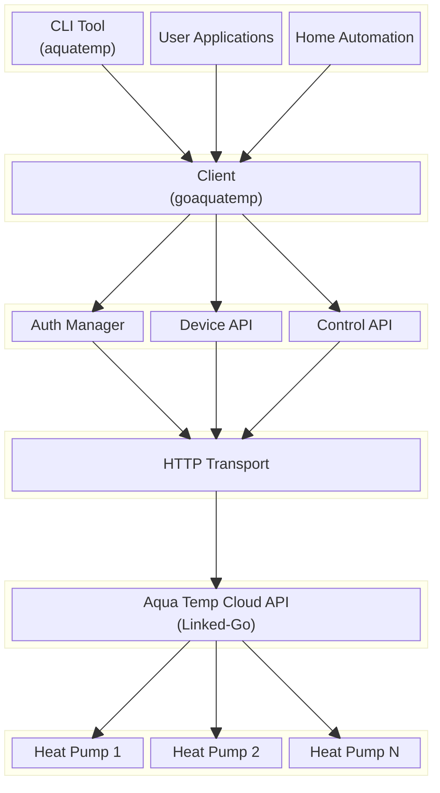

### Component Block Diagram

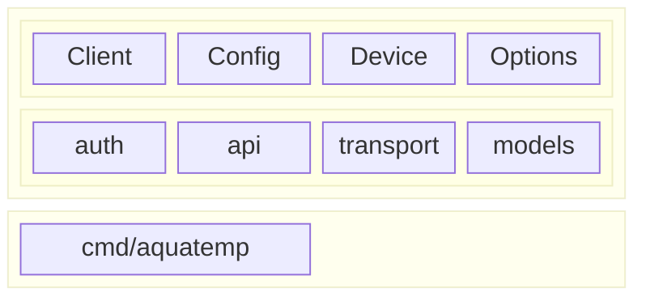

---

## Module Structure

```
goaquatemp/
├── client.go           # Main client interface and implementation
├── config.go           # Configuration types and defaults
├── device.go           # Device types and methods
├── errors.go           # Custom error types
├── options.go          # Functional options for client
├── doc.go              # Package documentation
│
├── internal/
│   ├── auth/
│   │   ├── auth.go         # Authentication manager
│   │   └── token.go        # Token storage and refresh
│   │
│   ├── api/
│   │   ├── endpoints.go    # API endpoint definitions
│   │   ├── requests.go     # Request builders
│   │   └── responses.go    # Response parsers
│   │
│   └── transport/
│       └── http.go         # HTTP client wrapper
│
├── cmd/
│   └── aquatemp/
│       ├── main.go         # CLI entry point
│       ├── commands.go     # Command definitions
│       └── output.go       # Output formatting
│
├── examples/
│   └── temperature/
│       └── main.go         # Example: get temperature data
│
└── docs/
    ├── general.md          # General API documentation
    └── DESIGN.md           # This document
```

---

## Core Components

### Client Interface

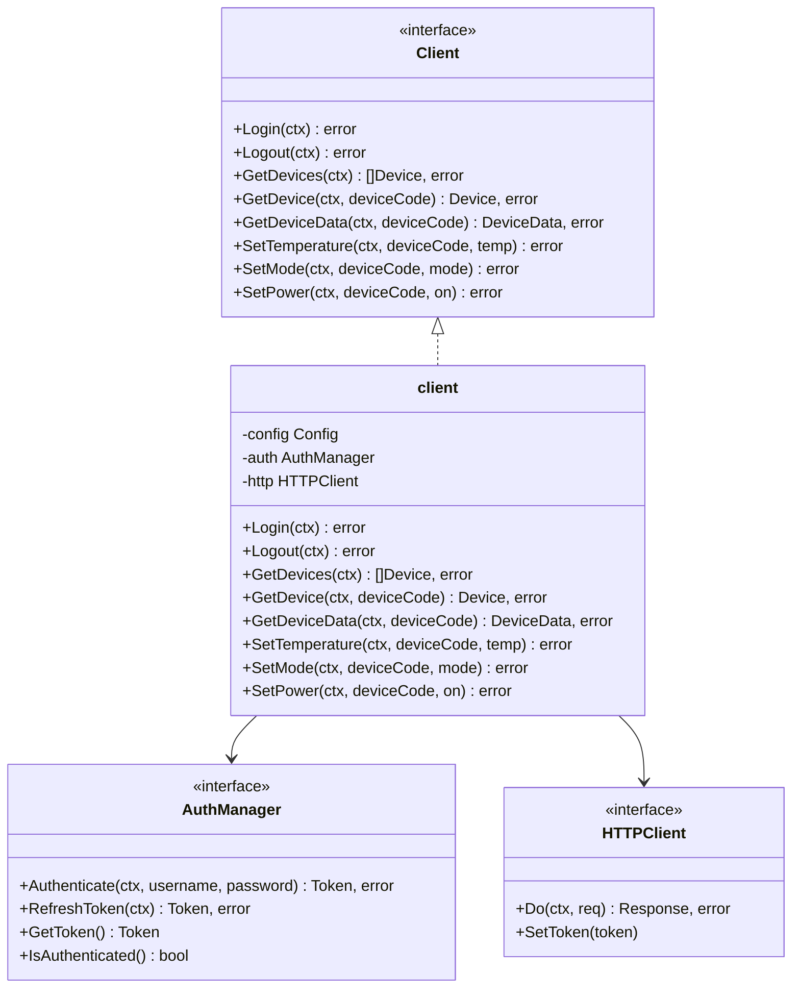

### Configuration

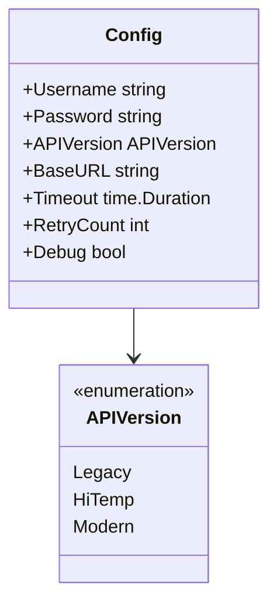

---

## Data Models

### Device and Sensor Data

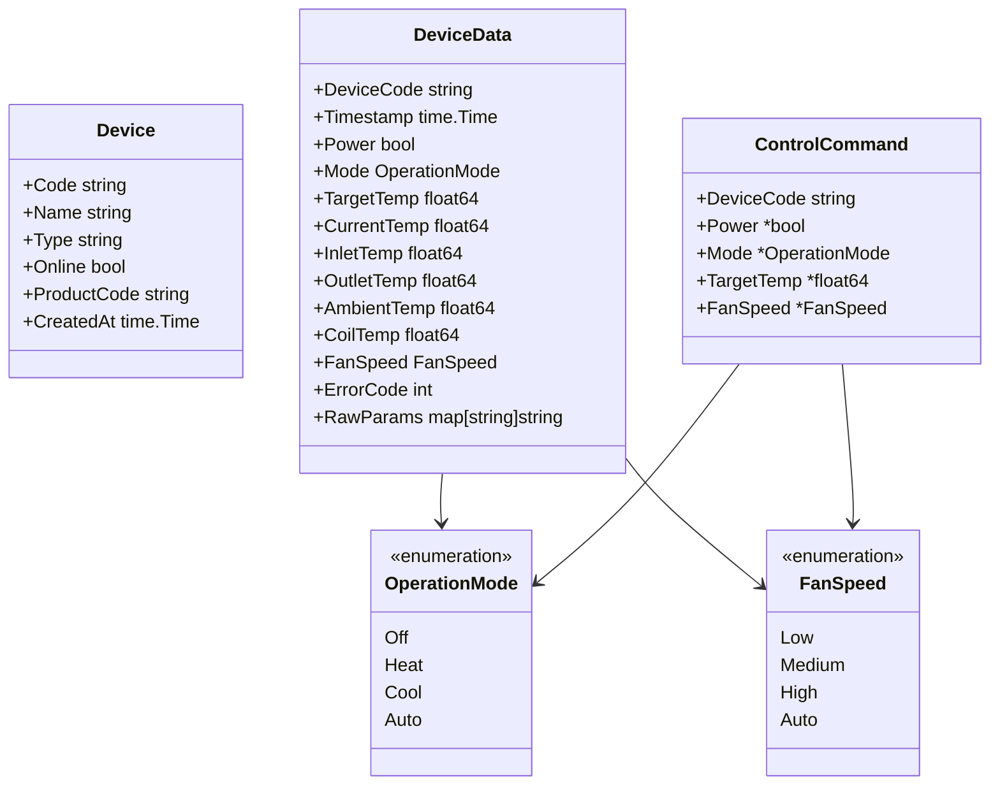

### API Response Models

```mermaid
classDiagram
    class APIResponse {
        +Error int
        +ErrorMessage string
        +Data interface{}
    }

    class LoginResponse {
        +Token string
        +UserID string
        +ExpiresIn int
    }

    class DeviceListResponse {
        +Devices []DeviceInfo
    }

    class DeviceDataResponse {
        +ObjectResult []Parameter
    }

    class Parameter {
        +Code string
        +Value string
    }

    APIResponse <|-- LoginResponse
    APIResponse <|-- DeviceListResponse
    APIResponse <|-- DeviceDataResponse
    DeviceDataResponse --> Parameter
```

---

## Sequence Diagrams

### Authentication Flow

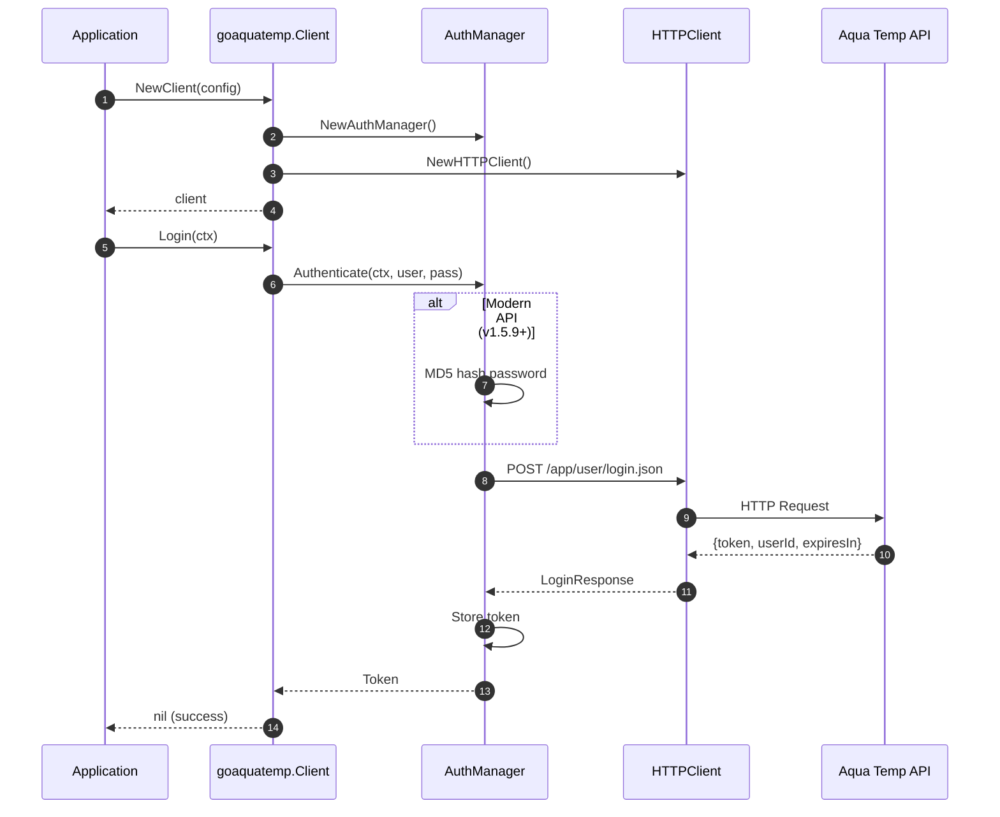

### Get Device Temperature Data

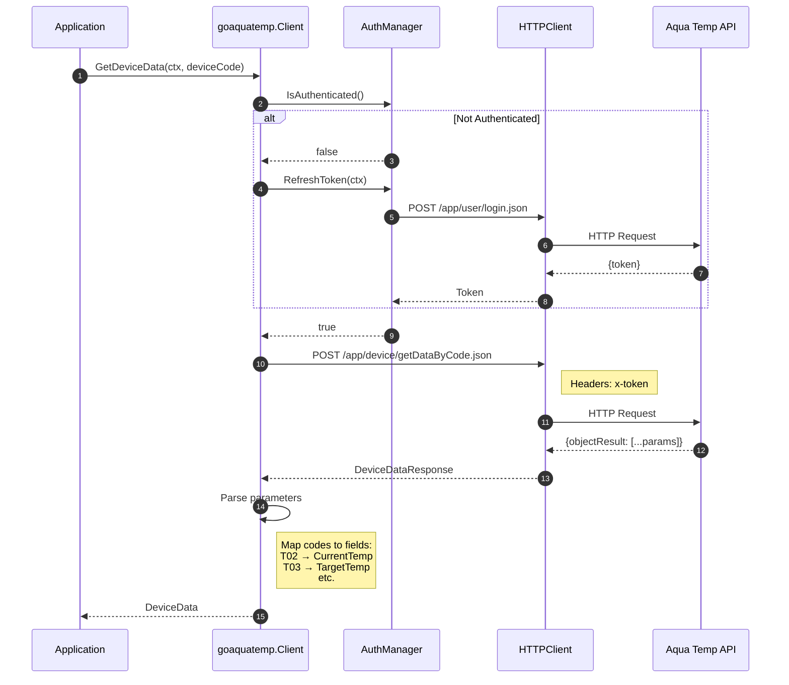

### Control Device (Set Temperature)

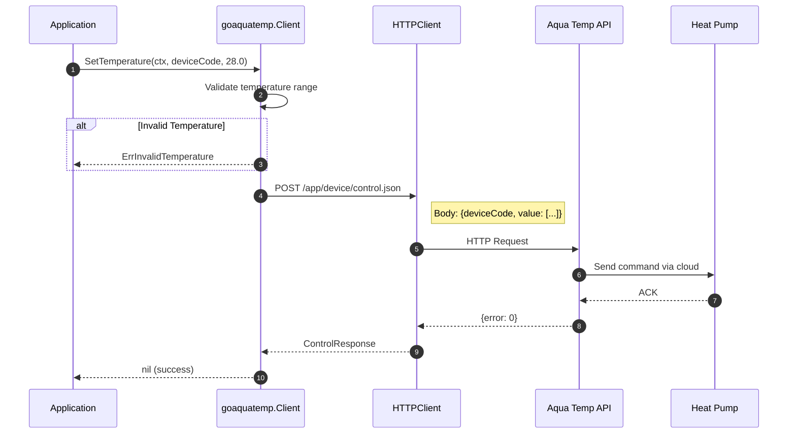

### Complete CLI Workflow

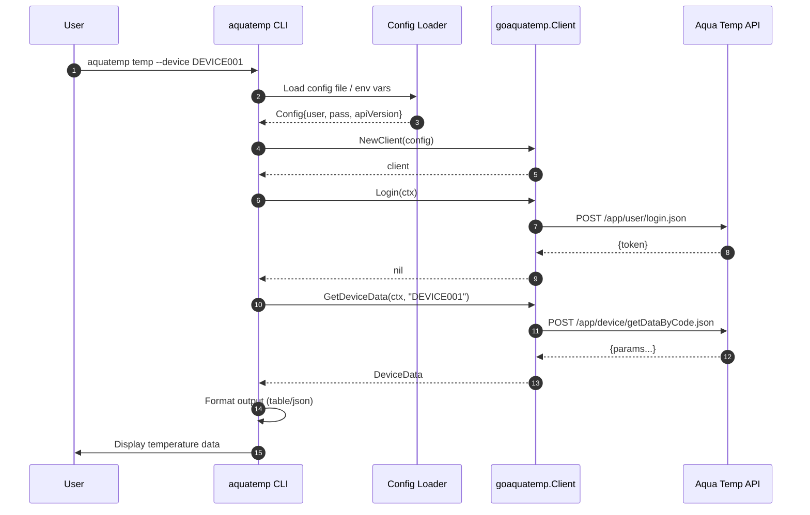

---

## CLI Tool Design

### Command Structure

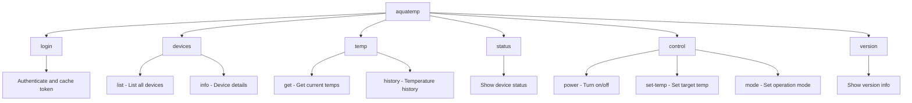

### CLI Commands

| Command | Subcommand | Description | Example |
|---------|------------|-------------|---------|
| `login` | - | Authenticate with API | `aquatemp login` |
| `devices` | `list` | List all devices | `aquatemp devices list` |
| `devices` | `info` | Show device details | `aquatemp devices info -d CODE` |
| `temp` | `get` | Get temperature data | `aquatemp temp get -d CODE` |
| `temp` | `history` | Get temperature history | `aquatemp temp history -d CODE --hours 24` |
| `status` | - | Show full device status | `aquatemp status -d CODE` |
| `control` | `power` | Turn device on/off | `aquatemp control power -d CODE --on` |
| `control` | `set-temp` | Set target temperature | `aquatemp control set-temp -d CODE -t 28` |
| `control` | `mode` | Set operation mode | `aquatemp control mode -d CODE --heat` |
| `version` | - | Show version | `aquatemp version` |

### CLI Output Formats

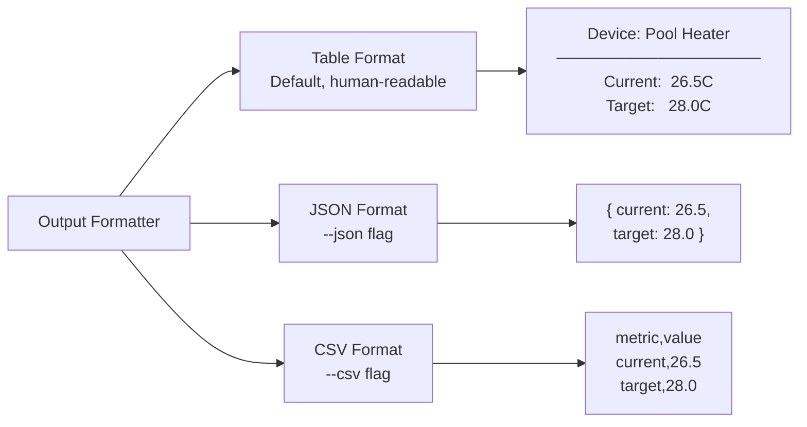

---

## Error Handling

### Error Types

```mermaid
classDiagram
    class Error {
        <<interface>>
        +Error() string
    }

    class AuthError {
        +Code int
        +Message string
        +Retryable bool
        +Error() string
        +Unwrap() error
    }

    class APIError {
        +StatusCode int
        +ErrorCode int
        +Message string
        +Error() string
    }

    class DeviceError {
        +DeviceCode string
        +Operation string
        +Cause error
        +Error() string
        +Unwrap() error
    }

    class ValidationError {
        +Field string
        +Value interface{}
        +Message string
        +Error() string
    }

    Error <|.. AuthError
    Error <|.. APIError
    Error <|.. DeviceError
    Error <|.. ValidationError
```

### Error Handling Flow

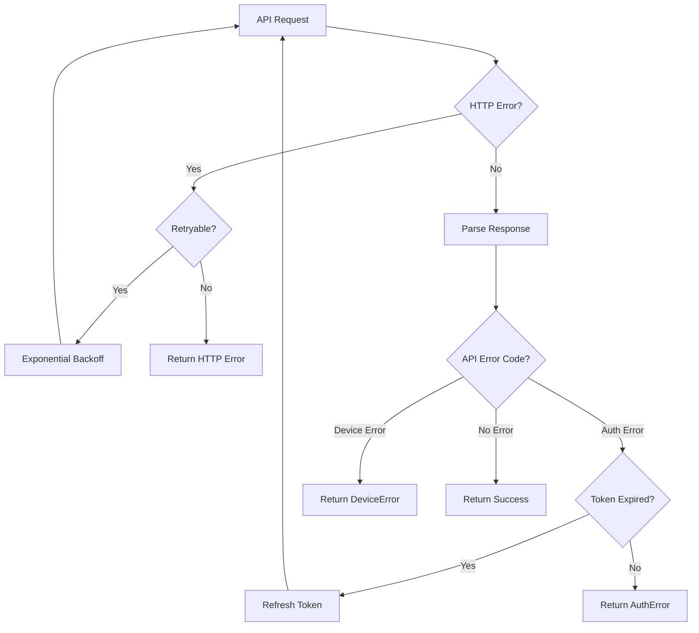

---

## Configuration

### Configuration Sources (Priority Order)

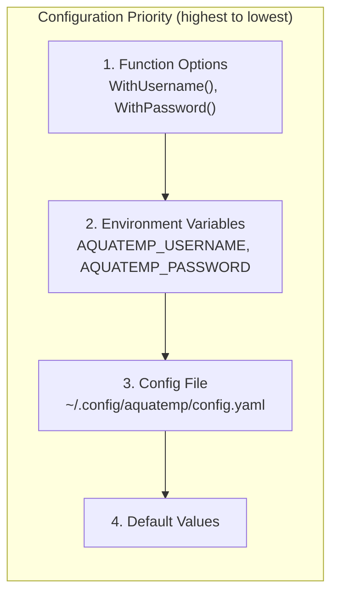

### Configuration File Format

```yaml
# ~/.config/aquatemp/config.yaml
username: "user@example.com"
password: "secret"           # Or use AQUATEMP_PASSWORD env var
api_version: "modern"        # legacy, hitemp, or modern
base_url: ""                 # Override auto-detected URL
timeout: "30s"
retry_count: 3
debug: false

# Default device (optional)
default_device: "DEVICE001"
```

### Environment Variables

| Variable | Description | Default |
|----------|-------------|---------|
| `AQUATEMP_USERNAME` | Account username/email | - |
| `AQUATEMP_PASSWORD` | Account password | - |
| `AQUATEMP_API_VERSION` | API version (legacy/hitemp/modern) | `modern` |
| `AQUATEMP_BASE_URL` | Override base URL | Auto-detected |
| `AQUATEMP_TIMEOUT` | Request timeout | `30s` |
| `AQUATEMP_DEBUG` | Enable debug logging | `false` |
| `AQUATEMP_CONFIG` | Config file path | `~/.config/aquatemp/config.yaml` |

---

## Example Usage

### Basic Example: Get Temperature Data

```go
package main

import (
    "context"
    "fmt"
    "log"
    "os"
    "time"

    "github.com/emergingrobotics/goaquatemp"
)

func main() {
    // Create client with configuration
    client, err := goaquatemp.NewClient(
        goaquatemp.WithUsername(os.Getenv("AQUATEMP_USERNAME")),
        goaquatemp.WithPassword(os.Getenv("AQUATEMP_PASSWORD")),
        goaquatemp.WithAPIVersion(goaquatemp.APIModern),
        goaquatemp.WithTimeout(30*time.Second),
    )
    if err != nil {
        log.Fatalf("Failed to create client: %v", err)
    }

    ctx := context.Background()

    // Authenticate
    if err := client.Login(ctx); err != nil {
        log.Fatalf("Login failed: %v", err)
    }
    defer client.Logout(ctx)

    // Get list of devices
    devices, err := client.GetDevices(ctx)
    if err != nil {
        log.Fatalf("Failed to get devices: %v", err)
    }

    if len(devices) == 0 {
        log.Fatal("No devices found")
    }

    // Get temperature data for first device
    device := devices[0]
    data, err := client.GetDeviceData(ctx, device.Code)
    if err != nil {
        log.Fatalf("Failed to get device data: %v", err)
    }

    // Display temperature data
    fmt.Printf("Device: %s (%s)\n", device.Name, device.Code)
    fmt.Printf("Timestamp: %s\n", data.Timestamp.Format(time.RFC3339))
    fmt.Println("─────────────────────────────")
    fmt.Printf("Power:       %s\n", formatPower(data.Power))
    fmt.Printf("Mode:        %s\n", data.Mode)
    fmt.Printf("Target Temp: %.1f°C\n", data.TargetTemp)
    fmt.Printf("Current:     %.1f°C\n", data.CurrentTemp)
    fmt.Printf("Inlet:       %.1f°C\n", data.InletTemp)
    fmt.Printf("Outlet:      %.1f°C\n", data.OutletTemp)
    fmt.Printf("Ambient:     %.1f°C\n", data.AmbientTemp)
    fmt.Printf("Fan Speed:   %s\n", data.FanSpeed)
}

func formatPower(on bool) string {
    if on {
        return "ON"
    }
    return "OFF"
}
```

### Advanced Example: Monitor Temperature with Callbacks

```go
package main

import (
    "context"
    "fmt"
    "log"
    "time"

    "github.com/emergingrobotics/goaquatemp"
)

func main() {
    client, _ := goaquatemp.NewClient(
        goaquatemp.WithConfigFile("~/.config/aquatemp/config.yaml"),
    )

    ctx, cancel := context.WithCancel(context.Background())
    defer cancel()

    client.Login(ctx)
    defer client.Logout(ctx)

    devices, _ := client.GetDevices(ctx)
    deviceCode := devices[0].Code

    // Poll every 5 minutes
    ticker := time.NewTicker(5 * time.Minute)
    defer ticker.Stop()

    for {
        select {
        case <-ctx.Done():
            return
        case <-ticker.C:
            data, err := client.GetDeviceData(ctx, deviceCode)
            if err != nil {
                log.Printf("Error: %v", err)
                continue
            }

            fmt.Printf("[%s] Current: %.1f°C, Target: %.1f°C\n",
                time.Now().Format("15:04"),
                data.CurrentTemp,
                data.TargetTemp,
            )
        }
    }
}
```

---

## API Version Differences

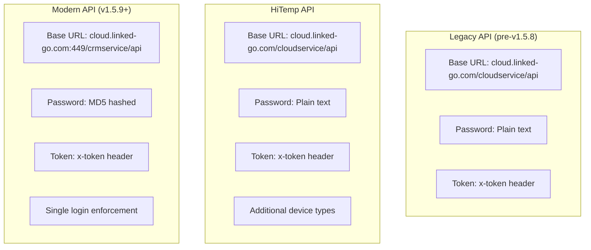

---

## Security Considerations

1. **Credential Storage**: Never store passwords in plain text; use environment variables or encrypted config files
2. **Token Management**: Tokens should be stored securely and refreshed before expiration
3. **HTTPS Only**: All API communication uses HTTPS
4. **Single Login**: Be aware that logging in will invalidate other sessions; use a dedicated account for automation

---

## Testing Strategy

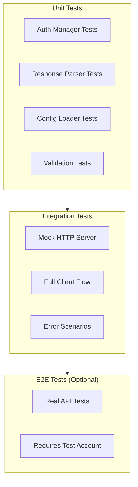

---

## Future Enhancements

1. **Local API Support**: Direct communication with heat pump (if supported)
2. **Prometheus Metrics**: Export metrics for monitoring
3. **Webhook Support**: Push notifications for status changes
4. **Multi-device Dashboard**: TUI for monitoring multiple devices
5. **Historical Data Export**: Export temperature history to CSV/InfluxDB
