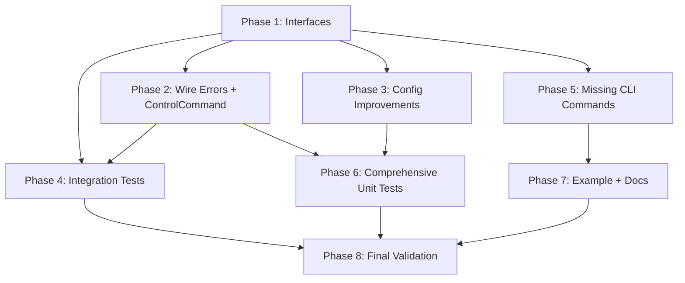

# goaquatemp Implementation Plan

## Current State

The project has a working foundation: SDK client with full CRUD operations, multi-source configuration, authentication with MD5 hashing, HTTP transport with retry/backoff, a cobra-based CLI, error types, and an example program. Unit tests exist for config, validation, token management, response parsing, and HTTP transport.

### Gaps vs DESIGN.md

| Gap | Category |
|-----|----------|
| No `AuthManager` interface (concrete struct only) | Testability |
| No `HTTPClient` interface (concrete struct only) | Testability |
| `ControlCommand` struct defined but unused | Dead code |
| `MultiControlRequest` defined but unused | Dead code |
| Sentinel errors defined but never returned | Dead code |
| `AQUATEMP_CONFIG` env var not supported | Config |
| No `login` CLI command | CLI |
| No `temp history` CLI subcommand | CLI |
| No `control fan-speed` CLI subcommand | CLI |
| No integration tests (full client flow with mock HTTP server) | Testing |
| No advanced monitoring example (polling/ticker) | Examples |
| Client methods not unit-testable (depend on concrete types) | Testing |

---

## Phases

### Phase 1: Interfaces and Dependency Injection

Extract interfaces for the two internal dependencies so that the client can be tested with fakes. This is foundational -- every later phase depends on this for testability.

#### 1.1 Define `HTTPClient` interface

**File:** `internal/transport/http.go`

Add an interface above the existing `Client` struct:

```go
type HTTPClient interface {
    Post(ctx context.Context, path string, body any, token string) ([]byte, error)
    Get(ctx context.Context, path string, token string) ([]byte, error)
    SetBaseURL(baseURL string)
}
```

The existing `Client` struct already satisfies this interface. No method signature changes needed.

#### 1.2 Define `AuthManager` interface

**File:** `internal/auth/auth.go`

Add an interface above the existing `Manager` struct:

```go
type AuthManager interface {
    Authenticate(ctx context.Context) error
    RefreshToken(ctx context.Context) error
    GetToken() *Token
    GetTokenValue() string
    IsAuthenticated() bool
    Clear()
    EnsureAuthenticated(ctx context.Context) error
}
```

The existing `Manager` struct already satisfies this interface. No method signature changes needed.

#### 1.3 Update `client` struct to use interfaces

**File:** `client.go`

Change the `client` struct fields from concrete types to interfaces:

```go
type client struct {
    config *Config
    auth   auth.AuthManager
    http   transport.HTTPClient
}
```

Update `NewClient` to construct the concrete implementations as before but store them via the interface types.

#### 1.4 Tests

**File:** `client_interface_test.go` (or add to `client_test.go`)

- Verify that `*auth.Manager` satisfies `auth.AuthManager`
- Verify that `*transport.Client` satisfies `transport.HTTPClient`
- Compile-time assertions: `var _ auth.AuthManager = (*auth.Manager)(nil)`

**Pass criteria:** `make test` passes. All existing tests still pass. No behavior change.

---

### Phase 2: Wire Sentinel Errors and Use ControlCommand

Connect the defined-but-unused types and errors to the actual code paths.

#### 2.1 Return sentinel errors from client methods

**File:** `client.go`

| Location | Change |
|----------|--------|
| `ensureAuth` when `auth.IsAuthenticated()` returns false after refresh | Wrap with `ErrNotAuthenticated` |
| `Login` when API returns auth error | Wrap with `ErrInvalidCredentials` |
| `ensureAuth` when token refresh fails due to expiry | Wrap with `ErrTokenExpired` |
| `GetDevice` when device code not found in list | Return `ErrDeviceNotFound` |
| `GetDeviceData`/`SetTemperature`/`SetMode`/`SetPower`/`SetFanSpeed` when device is offline | Return `ErrDeviceOffline` (requires checking device online status first, or wrapping API errors appropriately) |
| `SetTemperature` when validation fails | Return `ErrInvalidTemperature` (currently returns a `ValidationError`, wrap it) |
| `SetMode` when validation fails | Return `ErrInvalidMode` |

For each, wrap with the corresponding structured error type (`AuthError`, `DeviceError`, `ValidationError`) and use `fmt.Errorf` with `%w` to chain the sentinel error.

#### 2.2 Use `ControlCommand` in client control methods

**File:** `client.go`

Refactor `SetTemperature`, `SetMode`, `SetPower`, `SetFanSpeed` to optionally accept or internally construct a `ControlCommand`. Two approaches:

**Option A (minimal change):** Add a new `Control(ctx, command ControlCommand) error` method that dispatches to individual controls. Keep existing methods as convenience wrappers.

**Option B (remove dead code):** If `ControlCommand` adds no value over individual methods, remove it from `device.go`. The individual methods are cleaner.

**Recommended: Option A.** Add the `Control` method. Update the `Client` interface to include it.

#### 2.3 Use `MultiControlRequest` or remove it

**File:** `internal/api/requests.go`

If the Aqua Temp API supports multi-parameter control in a single request, wire `MultiControlRequest` into the `Control` method from 2.2. If it does not (based on the API docs showing single-parameter `/app/device/control.json`), remove `MultiControlRequest` and `NewMultiControlRequest`.

**Recommended:** Keep it. The `Control` method can use it when a `ControlCommand` has multiple fields set (power + mode + temp in one call).

#### 2.4 Tests

**File:** `client_test.go` (expand existing)

- Test that `SetTemperature` with out-of-range temp returns an error wrapping `ErrInvalidTemperature`
- Test that `SetMode` with invalid mode returns an error wrapping `ErrInvalidMode`
- Test sentinel error unwrapping with `errors.Is()`
- Test `Control` method with a `ControlCommand` having multiple fields set

**Pass criteria:** `make test` passes.

---

### Phase 3: Configuration Improvements

#### 3.1 Support `AQUATEMP_CONFIG` environment variable

**File:** `config.go`

In `LoadConfigFromEnv`, add:

```go
if v := os.Getenv("AQUATEMP_CONFIG"); v != "" {
    // This sets a custom config file path, not a config value.
    // Store it so the caller can use it.
}
```

Since the config file path is used by the option layer (not stored on `Config`), add a `ConfigPath` field to `Config`:

```go
ConfigPath string `yaml:"-"`
```

Read `AQUATEMP_CONFIG` in `LoadConfigFromEnv()` and set `ConfigPath`. Update `NewClient` to check `config.ConfigPath` and load from that path if set.

#### 3.2 Tests

**File:** `config_test.go` (new file)

- Test `LoadConfigFromEnv` reads all environment variables correctly
- Test `LoadConfigFromEnv` with `AQUATEMP_CONFIG` set
- Test `LoadConfigFile` with a valid YAML file (write to temp dir)
- Test `LoadConfigFile` with missing file returns no error (silent skip) or appropriate error
- Test `DefaultConfigPath` returns expected path

**Pass criteria:** `make test` passes.

---

### Phase 4: Integration Tests with Fake HTTP Server

Build integration tests that exercise the full client flow against a fake HTTP server. This validates the entire stack: client -> auth -> transport -> HTTP.

#### 4.1 Create test helper for fake API server

**File:** `internal/testutil/server.go` (new package)

Build a fake Aqua Temp API server using `net/http/httptest`:

```go
package testutil

type FakeServer struct {
    Server    *httptest.Server
    Devices   []api.DeviceInfo
    DeviceData map[string][]api.Parameter
    Token     string
    LoginCount int
}

func NewFakeServer() *FakeServer { ... }
func (f *FakeServer) Close() { ... }
```

The server should handle:
- `POST /app/user/login.json` -- validate credentials, return token
- `POST /app/device/deviceList.json` -- return configured devices
- `POST /app/device/getDataByCode.json` -- return configured device data
- `POST /app/device/control.json` -- accept control commands, return success
- Token validation on all non-login endpoints
- Configurable error responses for testing error paths

#### 4.2 Client integration tests

**File:** `client_integration_test.go`

Tests using the fake server:

| Test | Description |
|------|-------------|
| `LoginWithValidCredentials` | Login succeeds, token is stored |
| `LoginWithInvalidCredentials` | Login fails with `AuthError` wrapping `ErrInvalidCredentials` |
| `GetDevicesAfterLogin` | Login, list devices, verify device fields |
| `GetDeviceByCode` | Login, get specific device by code |
| `GetDeviceDataParsing` | Login, get device data, verify all temperature fields parsed correctly |
| `SetTemperatureSuccess` | Login, set temperature, verify API received correct request |
| `SetTemperatureOutOfRange` | Set temperature outside 15-40 range, verify `ErrInvalidTemperature` |
| `SetModeSuccess` | Login, set mode, verify API received correct mode value |
| `SetPowerOnOff` | Login, toggle power, verify API requests |
| `AutoReauthOnExpiredToken` | Login, expire token, make request, verify automatic re-auth |
| `DeviceNotFound` | Request data for nonexistent device code, verify `ErrDeviceNotFound` |
| `ServerErrorRetry` | Server returns 500 twice then 200, verify retry succeeds |
| `LogoutClearsToken` | Login, logout, verify `IsAuthenticated()` returns false |

#### 4.3 Auth integration tests

**File:** `internal/auth/auth_integration_test.go`

Tests for the auth manager against the fake server:

| Test | Description |
|------|-------------|
| `AuthenticateSuccess` | Authenticate and verify token stored |
| `AuthenticateModernMD5` | Verify password is MD5-hashed for modern API version |
| `AuthenticateLegacyPlaintext` | Verify password is sent plain for legacy API version |
| `RefreshTokenReauthenticates` | Call RefreshToken, verify it re-authenticates |
| `EnsureAuthenticatedSkipsIfValid` | Token valid, verify no network call made |
| `EnsureAuthenticatedRefreshesIfExpired` | Token expired, verify re-authentication |

**Pass criteria:** `make test` passes. All integration tests pass.

---

### Phase 5: Missing CLI Commands

#### 5.1 Add `login` command

**File:** `cmd/aquatemp/commands.go`

Add `newLoginCmd()`:

```go
func newLoginCmd() *cobra.Command {
    return &cobra.Command{
        Use:   "login",
        Short: "Authenticate with the Aqua Temp API",
        RunE: func(cmd *cobra.Command, args []string) error {
            client, err := getClient()
            if err != nil {
                return err
            }
            ctx := context.Background()
            if err := client.Login(ctx); err != nil {
                return fmt.Errorf("login failed: %w", err)
            }
            fmt.Println("Login successful")
            return nil
        },
    }
}
```

Register in `main.go`:

```go
rootCmd.AddCommand(newLoginCmd())
```

#### 5.2 Add `temp history` subcommand

**File:** `cmd/aquatemp/commands.go`

Add a `history` subcommand under the `temp` command. Since the Aqua Temp API does not have a dedicated history endpoint, this command polls `getDataByCode` at intervals and displays a time series.

```go
func newTempHistoryCmd() *cobra.Command {
    var hours int
    var interval int

    cmd := &cobra.Command{
        Use:   "history",
        Short: "Poll temperature data over time",
        RunE: func(cmd *cobra.Command, args []string) error {
            // Poll every `interval` seconds for `hours` hours
            // Display each reading with timestamp
        },
    }
    cmd.Flags().IntVar(&hours, "hours", 1, "Duration to poll in hours")
    cmd.Flags().IntVar(&interval, "interval", 300, "Poll interval in seconds")
    return cmd
}
```

Register under the temp command in `newTempCmd()`.

#### 5.3 Add `control fan-speed` subcommand

**File:** `cmd/aquatemp/commands.go`

Add a `fan-speed` subcommand under the `control` command:

```go
func newControlFanSpeedCmd() *cobra.Command {
    var speed string

    cmd := &cobra.Command{
        Use:   "fan-speed",
        Short: "Set fan speed",
        RunE: func(cmd *cobra.Command, args []string) error {
            // Validate speed is one of: low, medium, high, auto
            // Call client.SetFanSpeed()
        },
    }
    cmd.Flags().StringVar(&speed, "speed", "", "Fan speed: low, medium, high, auto")
    cmd.MarkFlagRequired("speed")
    return cmd
}
```

Register under the control command in `newControlCmd()`.

#### 5.4 Add `temp history` output formatter

**File:** `cmd/aquatemp/output.go`

Add `printTempHistory` for table/JSON/CSV output of time-series temperature data.

#### 5.5 Tests

**File:** `cmd/aquatemp/main_test.go` (expand existing)

| Test | Description |
|------|-------------|
| `LoginCmdExists` | Verify login command is registered |
| `TempHistoryCmdExists` | Verify temp history subcommand is registered |
| `ControlFanSpeedCmdExists` | Verify control fan-speed subcommand is registered |
| `TempHistoryFlags` | Verify --hours and --interval flags exist |
| `ControlFanSpeedFlags` | Verify --speed flag exists and is required |

**Pass criteria:** `make test` passes.

---

### Phase 6: Comprehensive Unit Test Coverage

Fill in the unit test gaps identified in the current codebase.

#### 6.1 Client method tests with fakes

**File:** `client_test.go` (expand)

Now that interfaces exist (Phase 1), create fake implementations:

```go
type fakeAuthManager struct {
    authenticated bool
    token         *auth.Token
    authenticateError error
}

type fakeHTTPClient struct {
    responses map[string][]byte
    errors    map[string]error
    requests  []capturedRequest
}
```

Tests:

| Test | Description |
|------|-------------|
| `LoginCallsAuthenticate` | Verify Login delegates to auth manager |
| `LogoutClearsAuth` | Verify Logout calls auth.Clear() |
| `GetDevicesReturnsDeviceList` | Verify response parsing with fake HTTP |
| `GetDeviceFindsMatchByCode` | Verify correct device is selected from list |
| `GetDeviceReturnsErrorForMissingCode` | Verify ErrDeviceNotFound |
| `GetDeviceDataParsesSensorValues` | Verify all temperature fields parsed |
| `SetTemperatureValidatesRange` | Verify low/high bounds rejected |
| `SetModeSendsCorrectAPIValue` | Verify mode string mapping |
| `SetPowerSendsCorrectValue` | Verify on=1, off=0 |
| `EnsureAuthRefreshesExpiredToken` | Verify re-auth on expired token |

#### 6.2 Auth manager tests

**File:** `internal/auth/auth_test.go` (expand)

| Test | Description |
|------|-------------|
| `PreparePasswordModernMD5` | Verify MD5 hash for modern version |
| `PreparePasswordLegacyPlain` | Verify plain text for legacy version |
| `PreparePasswordHiTempPlain` | Verify plain text for hitemp version |
| `FormatTokenHeader` | Verify "bearer <token>" format |
| `EnsureAuthenticatedWhenValid` | Verify no network call when token valid |
| `EnsureAuthenticatedWhenExpired` | Verify re-authentication when token expired |

#### 6.3 Response parsing edge cases

**File:** `internal/api/responses_test.go` (expand)

| Test | Description |
|------|-------------|
| `ParseDeviceDataMissingParameters` | Verify defaults for missing codes |
| `ParseDeviceDataEmptyValues` | Verify empty strings parse to zero values |
| `ParsedCreateTimeValidFormat` | Verify time parsing for known format |
| `ParsedCreateTimeInvalidFormat` | Verify fallback for bad format |

#### 6.4 Config loading tests

**File:** `config_test.go` (from Phase 3, expand if needed)

| Test | Description |
|------|-------------|
| `LoadConfigFileValidYAML` | Parse all fields from YAML |
| `LoadConfigFileMissingFile` | Returns error or nil (verify behavior) |
| `LoadConfigFromEnvAllVars` | Set all env vars, verify all fields |
| `LoadConfigFromEnvPartialVars` | Set some vars, verify only those fields change |
| `LoadConfigFromEnvInvalidTimeout` | Bad timeout value handling |

**Pass criteria:** `make test` passes. `make test-cover` shows improved coverage.

---

### Phase 7: Advanced Example and Documentation

#### 7.1 Add monitoring example

**File:** `examples/monitor/main.go` (new file)

Implement the polling/ticker example from DESIGN.md:

```go
package main

import (
    "context"
    "fmt"
    "log"
    "os"
    "os/signal"
    "time"

    "github.com/user/goaquatemp"
)

func main() {
    client, err := goaquatemp.NewClient(
        goaquatemp.WithEnvConfig(),
    )
    if err != nil {
        log.Fatal(err)
    }

    ctx, cancel := signal.NotifyContext(context.Background(), os.Interrupt)
    defer cancel()

    if err := client.Login(ctx); err != nil {
        log.Fatal(err)
    }
    defer client.Logout(ctx)

    devices, err := client.GetDevices(ctx)
    if err != nil {
        log.Fatal(err)
    }
    if len(devices) == 0 {
        log.Fatal("no devices found")
    }

    deviceCode := devices[0].Code
    ticker := time.NewTicker(5 * time.Minute)
    defer ticker.Stop()

    for {
        select {
        case <-ctx.Done():
            return
        case <-ticker.C:
            data, err := client.GetDeviceData(ctx, deviceCode)
            if err != nil {
                log.Printf("error: %v", err)
                continue
            }
            fmt.Printf("[%s] Current: %.1fC, Target: %.1fC\n",
                time.Now().Format("15:04"),
                data.CurrentTemp,
                data.TargetTemp,
            )
        }
    }
}
```

#### 7.2 Update Makefile

**File:** `Makefile`

Add a `build-monitor` target and update `build-all` to include it.

#### 7.3 Update README.md

**File:** `README.md`

- Add the `login` command to the CLI usage section
- Add the `temp history` command to the CLI usage section
- Add the `control fan-speed` command to the CLI usage section
- Add the monitoring example to the examples section
- Update any outdated sections

**Pass criteria:** `make build-all` succeeds. `make test` passes. README reflects all commands.

---

### Phase 8: Final Validation

#### 8.1 Full test suite

```bash
make test-race
make test-cover
```

Verify:
- All tests pass with race detector enabled
- No data races detected
- Coverage report shows all new code is tested

#### 8.2 Lint and format

```bash
make fmt
make vet
make lint
```

Verify no warnings or errors.

#### 8.3 Build all artifacts

```bash
make build-all
```

Verify:
- CLI binary builds
- Both example binaries build
- No compilation errors

#### 8.4 Verify CLI commands

```bash
./aquatemp --help
./aquatemp login --help
./aquatemp devices list --help
./aquatemp temp get --help
./aquatemp temp history --help
./aquatemp status --help
./aquatemp control power --help
./aquatemp control set-temp --help
./aquatemp control mode --help
./aquatemp control fan-speed --help
./aquatemp version
```

Verify all commands show correct help text.

---

## Phase Dependency Graph



Phases 2, 3, and 5 can run in parallel after Phase 1 completes. Phase 4 depends on Phases 1 and 2. Phase 6 depends on Phases 1, 2, and 3. Phase 7 depends on Phase 5. Phase 8 is the final gate.

---

## Rules (from /claude/CLAUDE.md)

- No time estimates
- Never skip or bypass tests
- Never move to the next phase until all tests from the current phase pass
- Use `make test` to validate each phase
- Comments should not describe the process of changing code
- No emojis in code
- No abbreviations (use `number` not `num`, `temperature` not `temp` in variable names -- note: `temp` is acceptable as a parameter name since it is the domain term, not an abbreviation)
- Prefer editing existing files over creating new ones
- Test assertions should be strict (exact equality, not substring matching)
- Use fakes over mocks; do not mock our own code
- Commit messages: present tense verb, concise, no attribution footer
